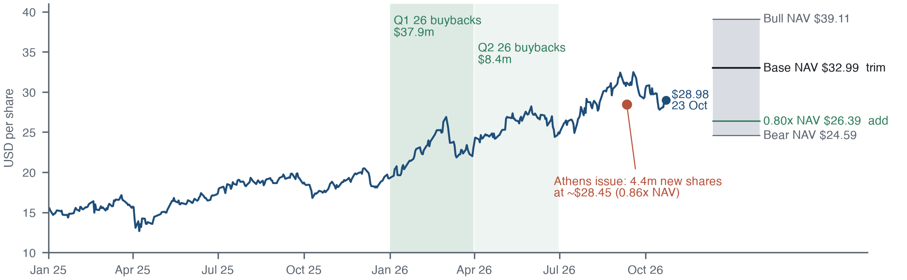

# Long Star Bulk: in a commodity, stewardship is the franchise

[Project one-pager (PDF)](docs/project-brief.pdf) · [Editable brief](docs/project-brief.md)

**A two-page long thesis on Star Bulk Carriers (Nasdaq: SBLK), with every number reproducible
from public filings and a vessel-level valuation model.** Dated snapshot: 23 October 2026 close.

Dry bulk has no pricing power, so the usual franchise tests fail. This thesis argues that in
a commodity the franchise is the operator's cost per ship-day, its balance sheet and its
discipline in trading ships and its own stock against the cycle. It then tests whether the
market already pays for that. The test is like for like against the closest US-listed peer,
Genco, with each company's fleet mix accounted for.

**[Read the thesis (PDF, 2 pages)](thesis/Ambekar_Star-Bulk_thesis.pdf)** ·
[Thesis source](thesis/thesis.md) ·
[Valuation model and company data](https://github.com/ambekarhrush/shipping-equity-research)



## What the evidence shows

| Measure, 23 October 2026 | Star Bulk | Genco |
| --- | ---: | ---: |
| Share price | $28.98 | $25.63 |
| Price / asset NAV (base) | 0.88x | 0.94x |
| Freight uplift needed on a flat mid-cycle rate vector | +4.3% | +13.8% |
| Capesize + Newcastlemax share of deadweight | 45% | 71% |
| Share of the Cal-27 FFA curve-shaped vector the price implies | 93% | 94% |
| Vessel opex per ship-day (reported) | $5,265 | $6,781 |
| Net debt / fleet value (model marks) | 10% | 21% |

- **The obvious comparison misleads.** On flat rates Genco looks far dearer, but most of the
  gap is fleet mix. Like for like, the market prices both at about the same share of the
  forward curve. That leaves Star Bulk the cheaper and better-run way to own the sector, and a
  Genco short a disguised Capesize bet rather than a hedge.
- **Valuation brackets the price.** Asset NAV is $24.59 / $32.99 / $39.11 (bear / base / bull).
  The finite-life DCF is $26.55 on flat mid-cycle rates and $33.51 on the Cal-27 curve held flat.
- **Stewardship is observable.** Star Bulk bought back $46.3m of stock in H1 2026, when the shares
  traded at $19–27, and issued 4.4m shares in Athens in September at about $28.45.

The thesis sets out the call, entry and sizing, dated conditions for being right or wrong, and
a pre-mortem of the risks. The 25/50/25 scenario weights behind its expected return are
judgement and are labelled as such.

## Reproduce

Requires [uv](https://docs.astral.sh/uv/) and a sibling checkout of the valuation model:

```bash
git clone https://github.com/ambekarhrush/shipping-equity-research.git
git clone https://github.com/ambekarhrush/star-bulk-long-thesis.git
cd star-bulk-long-thesis
uv run --with yfinance --with pandas python scripts/fetch_prices.py
uv run --project ../shipping-equity-research python scripts/pair_analytics.py --asof 2026-10-23
uv run --with matplotlib --with pandas python scripts/make_sblk_figure.py
uv run --with reportlab python scripts/build_thesis.py
```

`fetch_prices.py` downloads vendor prices into `data/`, which is not committed.
`pair_analytics.py` refreshes only the share price; every other input comes from the dated
SBLK (9 October) and GNK (12 October) company packages. Results land in
[`outputs/pair_results.json`](outputs/pair_results.json).

## Layout

```text
thesis/    thesis.md (source), the rendered PDF and Figure 1
scripts/   price download, valuation and freight tests, figure, PDF build
outputs/   pair_results.json and the relative-price series behind the analysis
```

## Limits

- **Dated marks.** NAV rests on June and August 2026 appraisals. Genco's fleet value is
  inferred from a rounded loan-to-value disclosure. A 5% error in the marks moves NAV by about
  6.5% of the share price.
- **Secondary-source FFAs.** The Cal-27 FFA levels (15 October 2026) come from a secondary
  source citing Baltic Exchange data, not a licensed curve. Holding the curve flat over ship
  lives is a stress view, not a forecast.
- **Partly secondary peer facts.** Some Genco and Diana Shipping facts come from press reports.
  The thesis cites them.
- **Not advice.** These are conditional estimates, not investment advice.
