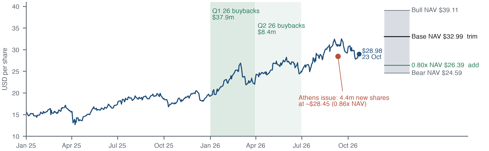

# Star Bulk Long Thesis

*Investment thesis dated 23 October 2026 · Prepared 5 November 2026*

## The research question

In a commodity business without pricing power, can stewardship create a measurable investment advantage?

## Approach

A two-page SBLK thesis connects ship-day costs, leverage, capital allocation, asset NAV and implied freight. A fleet-mix comparison against Genco separates operating quality from a disguised Capesize exposure. It reuses the independent shipping valuation engine.

## Evidence and result

The saved comparison reports SBLK at 0.88x base asset NAV versus GNK at 0.94x. Curve-shaped implied freight is much closer: 93% versus 94% of the selected Cal-27 vector. The argument includes entry conditions, a pre-mortem and explicitly judgmental scenario weights.

*SBLK stewardship and valuation; 23 October 2026 snapshot.*

## Scope and limitations

The share-price snapshot is 23 October; company inputs are earlier. Some appraisals and peer facts are secondary sources. A forward curve held flat over a ship’s life is a stress assumption. The thesis has no realized investment track record.

## Explore the project

Read thesis/Ambekar_Star-Bulk_thesis.pdf alongside outputs/pair_results.json. Rebuilding requires the sibling shipping-equity-research checkout and downloaded price inputs.

## Sources and evidence

[thesis/thesis.md](../thesis/thesis.md) · [outputs/pair_results.json](../outputs/pair_results.json)

---

Hrush Ambekar · Research snapshot reviewed 5 November 2026. See linked source files for full methodology, figures and reproducibility.
